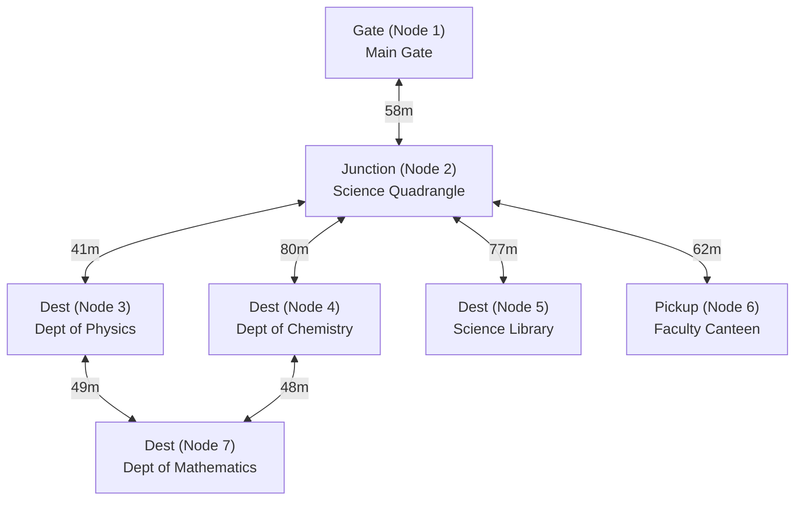

# 🗺️ Campus Graph & Path Planning Topology

> **Location:** University of Colombo — Faculty of Science  
> **Reference Datum:** WGS84 GPS (Decimal Degrees)

---

## Topological Node Map

---

## Node Inventory

| Node ID | Code | Location Name | Latitude | Longitude | Node Type |
|---|---|---|---|---|---|
| **1** | `MAIN_GATE` | Faculty Main Gate (Reid Ave) | `6.90150` | `79.86005` | Entry Point |
| **2** | `QUADRANGLE` | Science Quadrangle Junction | `6.90175` | `79.86050` | Central Hub / Junction |
| **3** | `PHYSICS` | Department of Physics | `6.90210` | `79.86060` | Delivery Destination |
| **4** | `CHEMISTRY` | Department of Chemistry | `6.90190` | `79.86120` | Delivery Destination |
| **5** | `LIBRARY` | Science Faculty Library | `6.90140` | `79.86110` | Delivery Destination |
| **6** | `CANTEEN` | Faculty Canteen / Cafeteria | `6.90120` | `79.86060` | Food Pickup Point |
| **7** | `MATHS` | Department of Mathematics | `6.90230` | `79.86100` | Delivery Destination |

---

## Edge Inventory (Path Segments)

Each edge represents an actual walkable path segment with pre-recorded/interpolated waypoints:

| Edge ID | From | To | Distance (m) | Type | Path Description |
|---|---|---|---|---|---|
| **1** | Main Gate (1) | Quadrangle (2) | 58 m | Paved walkway | Main entrance corridor |
| **2** | Quadrangle (2) | Physics (3) | 41 m | Paved walkway | North corridor to Physics dept |
| **3** | Quadrangle (2) | Chemistry (4) | 80 m | Paved walkway | East pathway across lawn |
| **4** | Quadrangle (2) | Library (5) | 77 m | Paved walkway | South-East path to Library |
| **5** | Quadrangle (2) | Canteen (6) | 62 m | Covered corridor | Direct access to Canteen |
| **6** | Physics (3) | Mathematics (7) | 49 m | Paved walkway | North cross-connection |
| **7** | Chemistry (4) | Mathematics (7) | 48 m | Paved walkway | East cross-connection |

---

## Shortest Path Planning (Dijkstra / A*)

When an order is created, the backend finds the shortest path by minimizing the sum of edge weights:
* **Example Order:** Canteen (Node 6) → Physics (Node 3)
  * Route: `Node 6` ➔ `Node 2` ➔ `Node 3`
  * Total Distance: `62m + 41m = 103 meters`
  * Waypoints transmitted to robot: Concatenation of waypoints along Edge 5 (reversed) + Edge 2.
